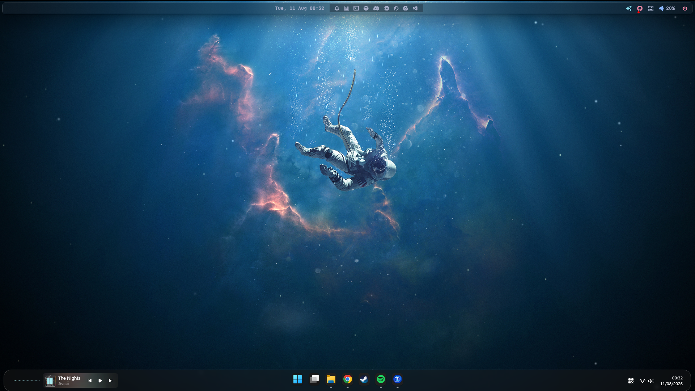
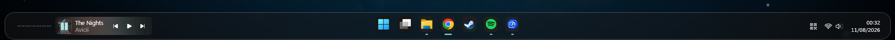
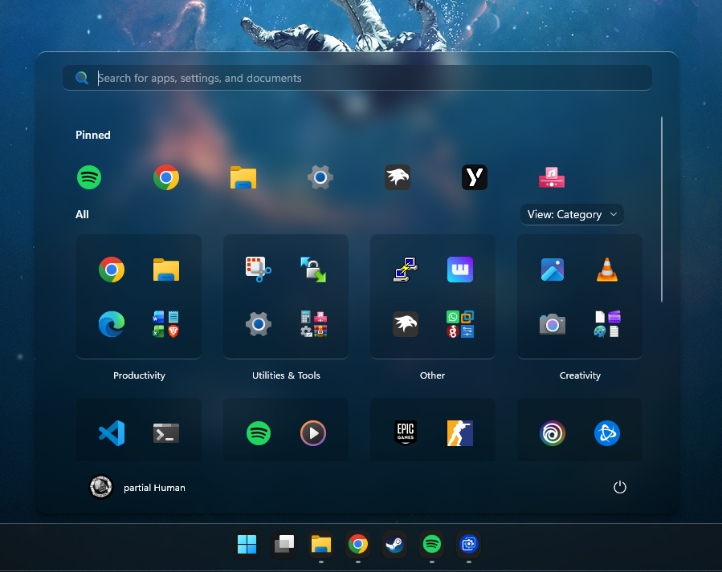
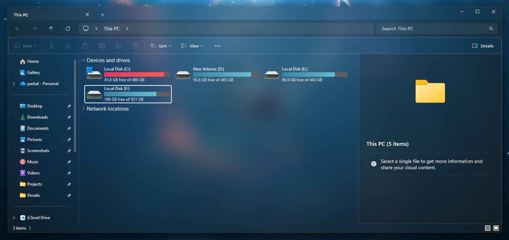
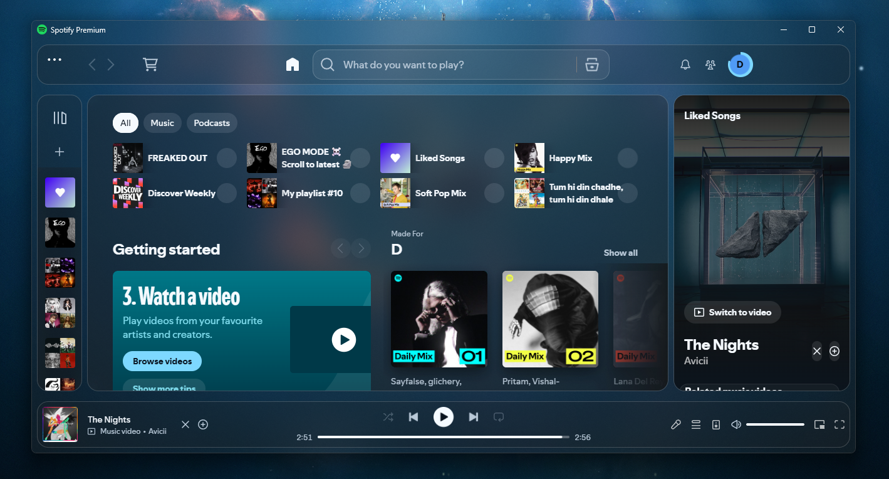
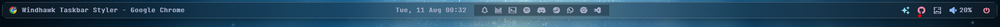

# Windows Liquid Glass Theme

[](https://www.microsoft.com/windows/windows-11)
[](https://windhawk.net/)
[](https://github.com/amnweb/yasb)
[](https://spicetify.app/)
[](https://github.com/unchihugo/FluentFlyout)
[](LICENSE)


A Windows 11 customization setup focused on a consistent **Liquid Glass / translucent desktop experience**.

This project combines Windhawk, YASB, Spicetify, Fluent Flyouts, and additional customization tools to create a unified glass-style interface across the Windows desktop, Taskbar, Start Menu, File Explorer, top bar, system flyouts, and Spotify.

---

## Preview

> Screenshots and preview images will be added to `assets/`.

### Desktop



### Taskbar



### Start Menu



### File Explorer



### Spotify



### YASB



> Replace the image filenames above with the actual files you add to
> `assets/previews/`.

---

# Features

## Windows UI

- Liquid Glass Taskbar
- Rounded Taskbar
- Transparent Taskbar background
- Custom Taskbar dimensions
- Custom Taskbar icon sizes
- Glass Task buttons
- Liquid Glass Start Menu
- Custom Start Menu dimensions
- Start Menu blur and transparency
- Search customization
- Transparent File Explorer
- Explorer navigation glass
- Explorer command bar styling
- Acrylic/translucent Windows
- Custom system flyouts

## Custom Top Bar

- YASB custom top bar
- Custom widgets
- Custom CSS styling
- Rounded widget containers
- Custom typography
- JetBrains Mono Nerd Font
- System information widgets

## Spotify

- Liquid Glass Spotify interface
- Transparent main background
- Glass top bar
- Glass left sidebar
- Glass right sidebar
- Glass middle content
- Glass bottom player
- Transparent filter/action bar
- Rounded cards
- Glass borders
- Custom Spotify colors
- Custom spacing and layout

## Additional Effects

- Taskbar dock-style animation
- Custom taskbar height
- Custom icon size
- Fluent Flyouts
- Spotify CEF tweaks

---

# Components

| Component | Tool | Configuration |
|---|---|---|
| Taskbar | Windows 11 Taskbar Styler | [`taskbar-styler.yaml`](configs/Windows-11-Taskbar-Styler/taskbar-styler.yaml) |
| Start Menu | Windows 11 Start Menu Styler | [`start-menu-styler.yaml`](configs/Windows-11-Start-Menu-Styler/start-menu-styler.yaml) |
| File Explorer | Windows 11 File Explorer Styler | [`file-explorer-styler.yaml`](configs/Windows-11-File-Explorer-Styler/file-explorer-styler.yaml) |
| Windows transparency | Translucent Windows | [`translucent-windows.yaml`](configs/Translucent-Windows/translucent-windows.yaml) |
| Taskbar sizing | Taskbar height and icon size | [`taskbar-icon-size.yaml`](configs/Taskbar-Height-and-Icon-Size/taskbar-icon-size.yaml) |
| Taskbar animation | Taskbar Dock Animation | [`taskbar-dock-animation.yaml`](configs/Taskbar-Dock-Animation/taskbar-dock-animation.yaml) |
| Top bar | YASB | [`config.yaml`](configs/YASB/config.yaml) / [`styles.css`](configs/YASB/styles.css) |
| Spotify theme | Spicetify | [`color.ini`](spotify/color.ini) / [`user.css`](spotify/user.css) |
| Spotify CEF | CEF Spotify Tweaks | [`config.yaml`](configs/CEF-Spotify-Tweaks/config.yaml) |
| System flyouts | Fluent Flyouts | [`FluentFlyout_Settings.xml`](configs/Fluent-Flyouts/FluentFlyout_Settings.xml) |

---

# Documentation
| Document | Description |
|--|--|
|[Installation Guide](docs/installation.md)|	Complete installation instructions|
|[Requirements](docs/requirements.md)|	Software and system requirements|
|[Configuration](docs/requirements.md)|Customization parameters and explanations|
|[Troubleshooting](docs/troubleshooting.md)| Common problems and solutions|
|[Credits](credits.md)| Third-party projects and attribution|

---

# Requirements

The project is designed primarily for:

- Windows 11
- Windhawk
- YASB
- Spotify Desktop
- Spicetify

Additional components are optional.

See the complete requirements:

**[Requirements](docs/requirements.md)**

---

# Installation

The recommended installation order is:

1. Install Windhawk
2. Install Translucent Windows
3. Install Windows 11 Taskbar Styler
4. Install Taskbar Height and Icon Size
5. Install Taskbar Dock Animation
6. Install Windows 11 Start Menu Styler
7. Install Windows 11 File Explorer Styler
8. Install Fluent Flyouts
9. Install YASB
10. Install JetBrains Mono Nerd Font
11. Install Spotify
12. Install Spicetify
13. Apply the Spotify Liquid Glass configuration
14. Install CEF Spotify Tweaks

For the complete installation procedure:

**[Installation Guide](docs/installation.md)**

---

# Download Required Software

## Windhawk

[Official website](https://windhawk.net/)

Windhawk is used for the Windows UI modifications in this project.

---

## YASB

YASB [Official GitHub](https://github.com/amnweb/yasb)

YASB [Installation](https://github.com/amnweb/yasb/wiki/Installation) guide

YASB provides the custom top bar.

---

## Spicetify

Spicetify [Official website](https://spicetify.app/)

Spicetify [Installation](https://spicetify.app/docs/getting-started) guide

Spicetify provides the Spotify customization framework.

---

## Fluent Flyouts

Fluent Flyouts [Official GitHub](https://github.com/unchihugo/FluentFlyout)

Fluent Flyouts Latest [Releases](https://github.com/unchihugo/FluentFlyout/releases)

Fluent Flyouts provides customized Windows system/media flyouts.

---

# Repository Structure

```text
WINDOWS-LIQUID-GLASS-THEME/
│
├── .gitignore
├── LICENSE
├── credits.md
├── README.md
├── THIRD-PARTY-NOTICES.md
│
├── assets/
│   ├── fonts/
│   │   └── JetBrainsMonoNerdFontPropo-Regular.ttf
│   ├── previews/
│   │   ├── desktop.png
│   │   ├── file-explorer.png
│   │   ├── navigation-pannel.png
│   │   ├── notification-pannel.png
│   │   ├── spotify.png
│   │   ├── start-menu.png
│   │   ├── taskbar.png
│   │   └── yasb.png
│   └── screenshots/
│
├── configs/
│   │
│   ├── CEF-Spotify-Tweaks/
│   │   └── config.yaml
│   │
│   ├── Fluent-Flyouts/
│   │   └── FluentFlyout_Settings.xml
│   │
│   ├── Taskbar-Dock-Animation/
│   │   └── taskbar-dock-animation.yaml
│   │
│   ├── Taskbar-Height-and-Icon-Size/
│   │   └── taskbar-icon-size.yaml
│   │
│   ├── Translucent-Windows/
│   │   └── translucent-windows.yaml
│   │
│   ├── Windows-11-File-Explorer-Styler/
│   │   └── file-explorer-styler.yaml
│   │
│   ├── Windows-11-Start-Menu-Styler/
│   │   └── start-menu-styler.yaml
│   │
│   ├── Windows-11-Taskbar-Styler/
│   │   └── taskbar-styler.yaml
│   │
│   └── YASB/
│       ├── config.yaml
│       └── styles.css
│
├── docs/
│   ├── configuration.md
│   ├── installation.md
│   ├── requirements.md
│   └── troubleshooting.md
│
└── spotify/
    ├── color.ini
    └── user.css
```

---

# Credits

This project uses and builds upon several third-party tools and
projects.

See: [Credits & Attribution](credits.md)

# Disclaimer

This is an independent Windows customization project.

It is not officially affiliated with or endorsed by:

- Microsoft
- Spotify
- Windhawk
- YASB
- Spicetify
- Fluent Flyouts
- Other third-party projects used by this setup

Windows, Windows 11, Spotify, and other product names are trademarks
of their respective owners.

Use third-party customization tools at your own discretion.

Always maintain a backup of your original configurations.

---
