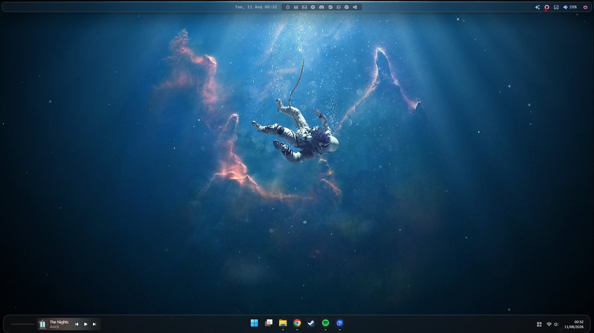
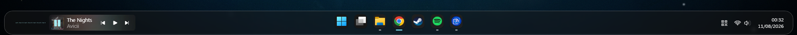
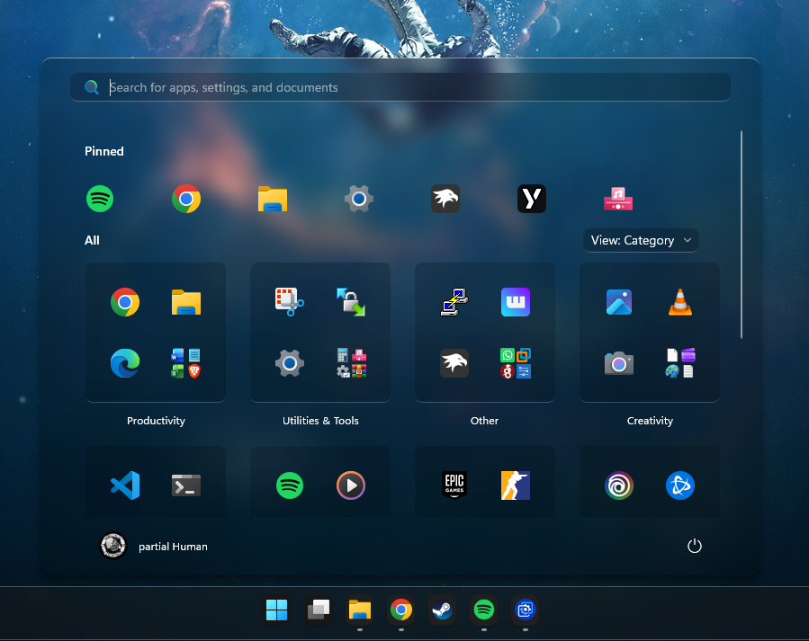
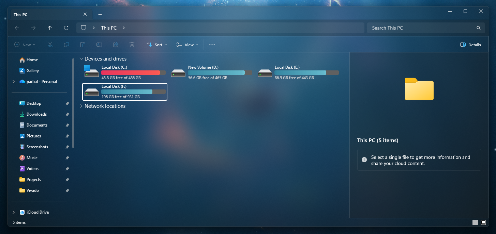
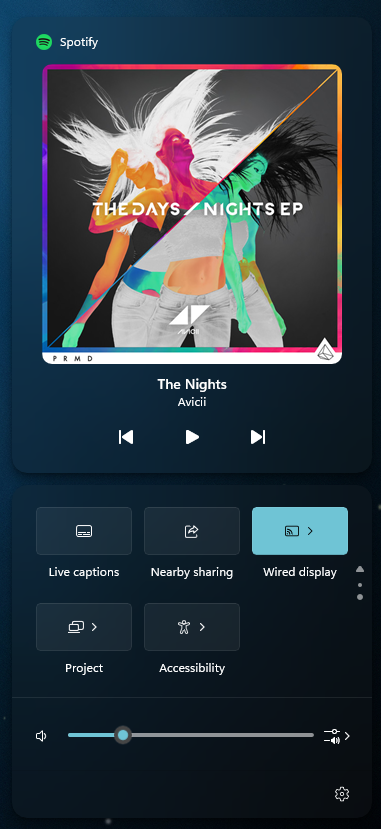
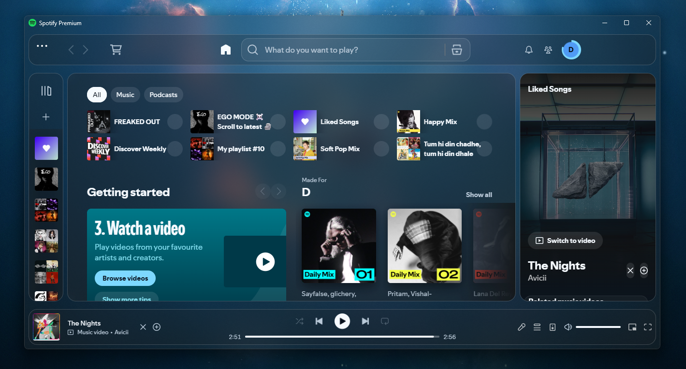
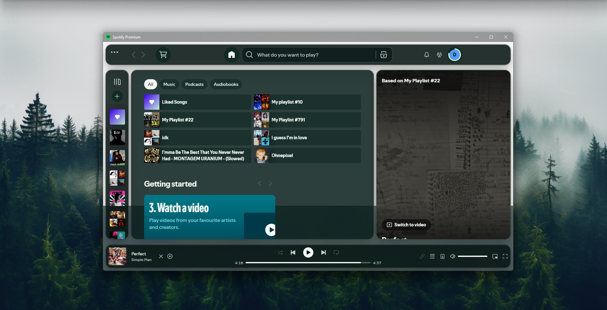
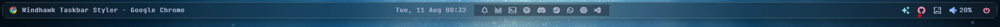

# Windows Liquid Glass Theme

[](https://www.microsoft.com/windows/windows-11)
[](https://windhawk.net/)
[](https://github.com/amnweb/yasb)
[](https://spicetify.app/)
[](https://github.com/unchihugo/FluentFlyout)
[](LICENSE)

A Windows 11 customization setup focused on a consistent **Liquid Glass / translucent desktop experience**.

This project combines Windhawk, YASB, Spicetify, Fluent Flyouts, and additional customization tools to create a unified glass-style interface across the Windows desktop, Taskbar, Start Menu, File Explorer, custom top bar, system flyouts, and Spotify.

---

## Preview

> Screenshots and preview images will be added to `assets/`.

### Desktop



### Taskbar



### Start Menu



### File Explorer



### Navigation Panel



### Notification Panel


### Spotify

#### Liquid Glass

A dark, translucent Spotify interface with floating glass panels, rounded controls, subtle borders, and a consistent dark appearance.



#### Misty Forest

A forest-inspired Spotify appearance featuring green-tinted glass surfaces, mint accents, enhanced blur, and diagonal glass highlights.



### YASB



---

# Features

## Windows UI

- Liquid Glass Taskbar
- Rounded Taskbar
- Transparent Taskbar background
- Custom Taskbar dimensions
- Custom Taskbar icon sizes
- Glass Task buttons
- Liquid Glass Start Menu
- Custom Start Menu dimensions
- Start Menu blur and transparency
- Search customization
- Transparent File Explorer
- Explorer navigation glass
- Explorer command bar styling
- Acrylic/translucent Windows
- Custom system flyouts

## Custom Top Bar

- YASB custom top bar
- Custom widgets
- Custom CSS styling
- Rounded widget containers
- Custom typography
- JetBrains Mono Nerd Font
- System information widgets

## Spotify

Two independent Spotify appearance configurations are included.

**Liquid Glass**
- Dark translucent interface
- Glass top bar
- Glass left and right sidebars
- Floating middle content
- Glass bottom player
- Transparent filter/action bar
- Rounded cards and controls
- Subtle glass borders
- Custom Spotify colors, spacing, and layout

**Misty Forest**
- Forest-inspired green glass appearance
- Mint-colored accents
- Translucent interface panels
- Enhanced background blur and saturation
- Diagonal glass highlights
- Wallpaper-coordinated appearance

Each variant includes its own `color.ini` and `user.css`.

## Additional Effects

- Taskbar dock-style animation
- Custom taskbar height
- Custom icon size
- Fluent Flyouts
- Spotify CEF tweaks

---

# Components

| Component | Tool | Configuration |
|---|---|---|
| Taskbar | Windows 11 Taskbar Styler | [`taskbar-styler.yaml`](configs/Windows%2011%20Taskbar%20Styler/taskbar-styler.yaml) |
| Start Menu | Windows 11 Start Menu Styler | [`start-menu-styler.yaml`](configs/Windows%2011%20Start%20Menu%20Styler/start-menu-styler.yaml) |
| File Explorer | Windows 11 File Explorer Styler | [`file-explorer-styler.yaml`](configs/Windows%2011%20File%20Explorer%20Styler/file-explorer-styler.yaml) |
| Windows transparency | Translucent Windows | [`translucent-windows.yaml`](configs/Translucent%20Windows/translucent-windows.yaml) |
| Taskbar sizing | Taskbar Height and Icon Size | [`taskbar-icon-size.yaml`](configs/Taskbar%20height%20and%20icon%20size/taskbar-icon-size.yaml) |
| Taskbar animation | Taskbar Dock Animation | [`taskbar-dock-animation.yaml`](configs/Taskbar%20Dock%20Animation/taskbar-dock-animation.yaml) |
| Top bar | YASB | [`config.yaml`](configs/yasb/config.yaml) / [`styles.css`](configs/yasb/styles.css) |
| Spotify Liquid Glass | Spicetify | [`color.ini`](spotify/Liquid-Glass/color.ini) / [`user.css`](spotify/Liquid-Glass/user.css) |
| Spotify Misty Forest | Spicetify | [`color.ini`](spotify/Misty-Forest/color.ini) / [`user.css`](spotify/Misty-Forest/user.css) |
| Spotify CEF | CEF Spotify Tweaks | [`config.yaml`](configs/CEF-Spotify%20Tweaks/config.yaml) |
| System flyouts | Fluent Flyouts | [`FluentFlyout_Settings.xml`](configs/Fluent%20Flyouts/FluentFlyout_Settings.xml) |

---

# Documentation

| Document | Description |
|---|---|
| [Installation Guide](docs/installation.md) | Installation instructions for the customization tools and configurations |
| [Requirements](docs/requirements.md) | Software and system requirements |
| [Configuration](docs/configuration.md) | Customization parameters and configuration explanations |
| [Troubleshooting](docs/troubleshooting.md) | Common problems and solutions |
| [Credits](docs/credits.md) | Third-party projects and attribution |

---

# Requirements

The project is designed primarily for:

- Windows 11
- Windhawk
- YASB
- Spotify Desktop
- Spicetify

Additional components are optional depending on the customization you want to apply.

See the complete [Requirements](docs/requirements.md).

---

# Installation

The recommended installation order is:

1. Install Windhawk.
2. Install Translucent Windows.
3. Install Windows 11 Taskbar Styler.
4. Install Taskbar Height and Icon Size.
5. Install Taskbar Dock Animation.
6. Install Windows 11 Start Menu Styler.
7. Install Windows 11 File Explorer Styler.
8. Install Fluent Flyouts.
9. Install YASB.
10. Install JetBrains Mono Nerd Font.
11. Install Spotify.
12. Install Spicetify.
13. Select and apply a Spotify theme variant.
14. Install CEF Spotify Tweaks.

For detailed instructions, see the [Installation Guide](docs/installation.md).

---

# Download Required Software

## Windhawk

[Official Website](https://windhawk.net/)

Windhawk is used for Windows UI modifications, including Taskbar, Start Menu, File Explorer, and other system customization components.

## YASB

- [Official GitHub Repository](https://github.com/amnweb/yasb)
- [Installation Guide](https://github.com/amnweb/yasb/wiki/Installation)

YASB provides the customizable desktop top bar and widget system.

## Spicetify

- [Official Website](https://spicetify.app/)
- [Installation Guide](https://spicetify.app/docs/getting-started)

Spicetify provides the Spotify customization framework used by both Spotify theme variants.

## Fluent Flyouts

- [Official GitHub Repository](https://github.com/unchihugo/FluentFlyout)
- [Latest Releases](https://github.com/unchihugo/FluentFlyout/releases)

Fluent Flyouts provides customized Windows system and media flyouts.

---

# Repository Structure

```text
📁 Windows-Liquid-Glass-Theme/
    ├── 📁 assets/
    │   ├── 📁 fonts/
    │   │   └── 📄 JetBrainsMonoNerdFontPropo-Regular.ttf
    │   ├── 📁 previews/
    │   │   ├── 🖼️ desktop.png
    │   │   ├── 🖼️ file-explorer.png
    │   │   ├── 🖼️ navigation-pannel.png
    │   │   ├── 🖼️ notification pannel.png
    │   │   ├── 🖼️ spotify.png
    │   │   ├── 🖼️ start-menu.png
    │   │   ├── 🖼️ taskbar.png
    │   │   └── 🖼️ yasb.png
    │   └── 📁 screenshots/
    │       ├── 🖼️ desktop1.png
    │       ├── 🖼️ desktop2.png
    │       ├── 🖼️ desktop3.png
    │       ├── 🖼️ desktop4.png
    │       ├── 🖼️ navigation-pannel1.png
    │       ├── 🖼️ notification pannel1.png
    │       ├── 🖼️ spotify1.png
    │       ├── 🖼️ spotify2.png
    │       ├── 🖼️ start-menu1.png
    │       ├── 🖼️ taskbar2.png
    │       ├── 🖼️ taskbar3.png
    │       ├── 🖼️ yasb1.png
    │       └── 🖼️ yasb2.png
    ├── 📁 configs/
    │   ├── 📁 CEF-Spotify Tweaks/
    │   │   └── 📄 config.yaml
    │   ├── 📁 Fluent Flyouts/
    │   │   └── 📄 FluentFlyout_Settings.xml
    │   ├── 📁 Taskbar Dock Animation/
    │   │   └── 📄 taskbar-dock-animation.yaml
    │   ├── 📁 Taskbar height and icon size/
    │   │   └── 📄 taskbar-icon-size.yaml
    │   ├── 📁 Translucent Windows/
    │   │   └── 📄 translucent-windows.yaml
    │   ├── 📁 Windows 11 File Explorer Styler/
    │   │   └── 📄 file-explorer-styler.yaml
    │   ├── 📁 Windows 11 Start Menu Styler/
    │   │   └── 📄 start-menu-styler.yaml
    │   ├── 📁 Windows 11 Taskbar Styler/
    │   │   └── 📄 taskbar-styler.yaml
    │   └── 📁 yasb/
    │       ├── 📄 config.yaml
    │       └── 🎨 styles.css
    ├── 📁 docs/
    │   ├── 📄 configuration.md
    │   ├── 📄 installation.md
    │   ├── 📄 requirements.md
    │   └── 📄 troubleshooting.md
    ├── 📁 spotify/
    │   ├── 📁 Liquid-Glass/
    │   │   ├── 🎨 color.ini
    │   │   └── 📄 user.css
    │   └── 📁 Misty-Forest/
    │       ├── 🎨 color.ini
    │       └── 📄 user.css
    ├── 📄 .gitignore
    ├── 📄 credits.md
    ├── 📄 LICENSE
    ├── 📄 README.md
    └── 📄 THIRD-PARTY-NOTICES.md

```

---

# Credits

This project uses and builds upon several third-party tools and projects.

See [Credits & Attribution](docs/credits.md).

---

# Disclaimer

This is an independent Windows customization project.

It is not officially affiliated with or endorsed by:

- Microsoft
- Spotify
- Windhawk
- YASB
- Spicetify
- Fluent Flyouts
- Other third-party projects used by this setup

> Windows, Windows 11, Spotify, and other product names are trademarks of their respective owners.

>Use third-party customization tools at your own discretion.

>Always maintain a backup of your original configurations.